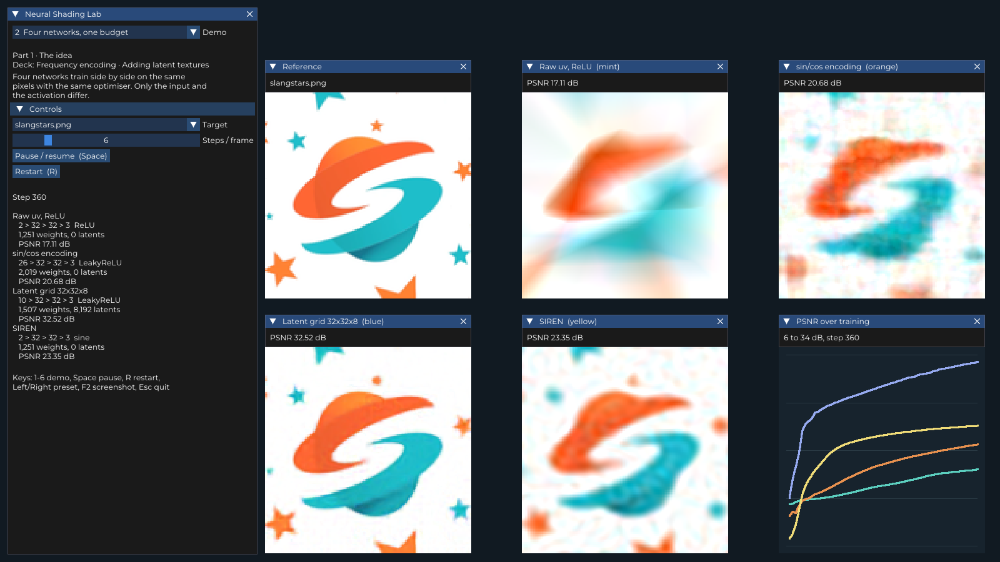
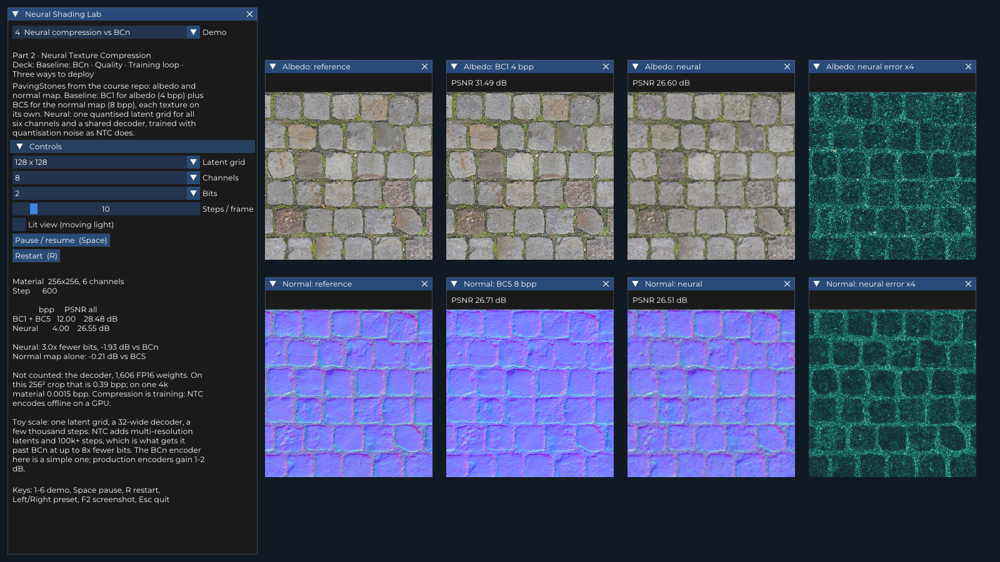
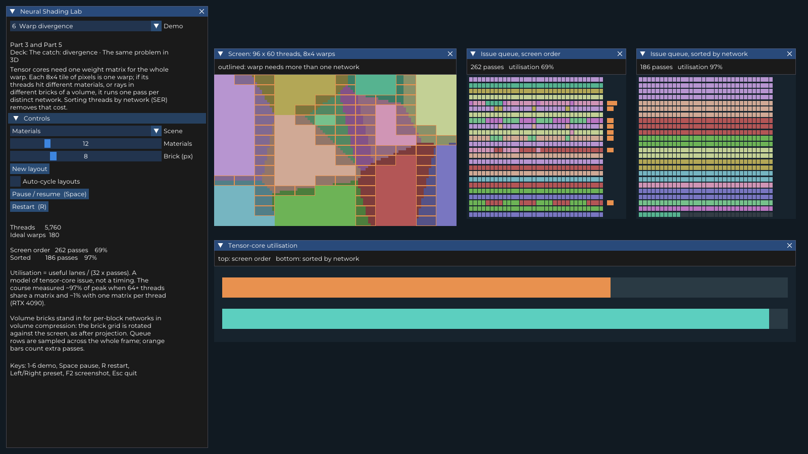
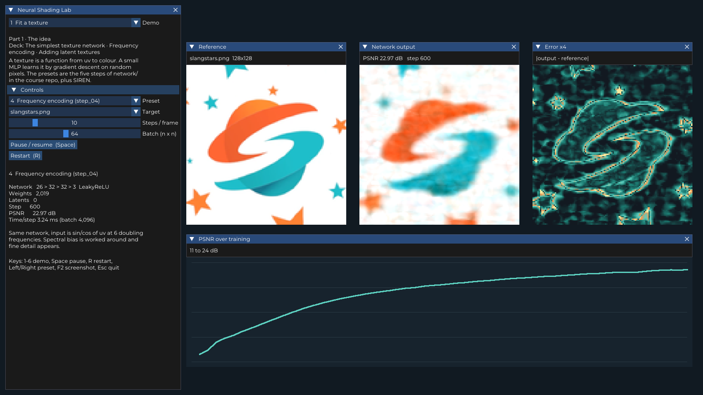
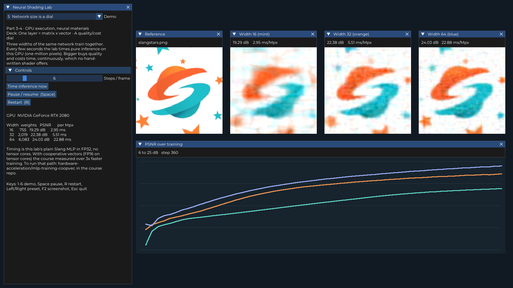
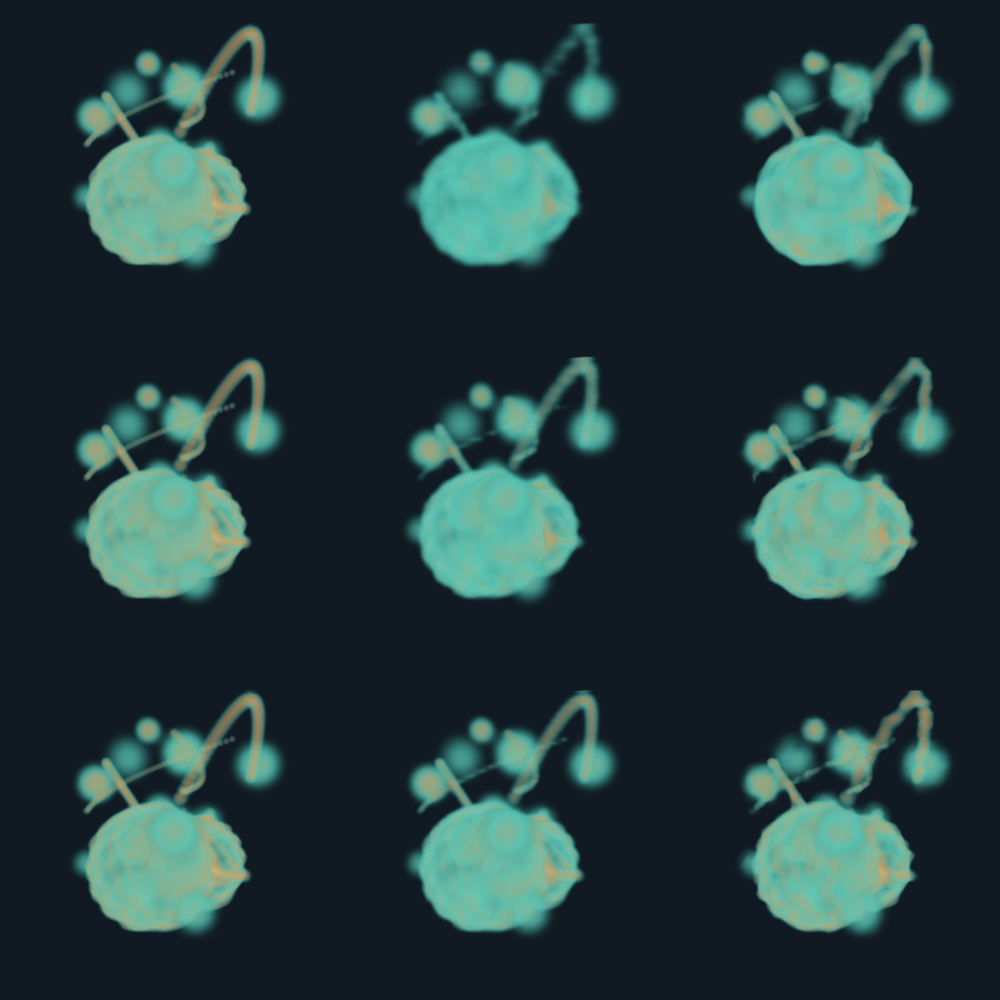

# Neural Shading Lab

Live GPU demos for the talk **Neural Shading & Neural Compression**: a digest of the SIGGRAPH 2025 course
[An Introduction to Neural Shading](https://github.com/shader-slang/neural-shading-s25), with a focus on
what transfers to neural compression of scientific volumes.

Every demo trains a small network in real time on the GPU with [Slang](https://shader-slang.org) autodiff
and [SlangPy](https://github.com/shader-slang/slangpy), built the same way as the course samples
(differentiable layers, atomic gradient accumulation, Adam).



## Demos

| # | Demo | What it shows |
| --- | --- | --- |
| 1 | **Fit a texture** | A texture as a function uv → rgb: one layer, hidden layers, LeakyReLU, frequency encoding, latent grid (course steps 01–05), plus SIREN. |
| 2 | **Four networks** | Raw uv, sin/cos encoding, latent grid and SIREN training side by side on the same pixels. |
| 3 | **SGD vs Adam** | Same network and noisy mini-batches, two optimisers; tune the SGD learning rate live. |
| 4 | **Neural compression vs BCn** | Albedo + normal map: BC1 + BC5 (12 bpp) against one quantised latent grid with a shared decoder (4 bpp), optional lit view. |
| 5 | **Network size is a dial** | Widths 16 / 32 / 64 train together; quality vs measured inference time on this GPU. |
| 6 | **Warp divergence** | Warps that hit more than one network, screen order vs sorted (SER), tensor-core utilisation; materials or volume bricks. |
| 7 | **Neural volume compression** | A 128³ simulation-like density volume as a 3D latent grid + MLP, ray-marched per sample, against a dense grid of the same byte size; times dense / on-sample / on-load. |

Talking points, controls and how each demo maps to the slides are in [`neural_lab/README.md`](neural_lab/README.md).

| | |
| --- | --- |
|  |  |
|  |  |

### Demo 7 result

Volume PSNR after 4000 steps, same number of bytes for both (decoder weights counted), 128³ FP16 original = 4.0 MB:

| Latent grid | Ratio | Size | Dense grid, same bytes | Neural | Δ |
| --- | --- | --- | --- | --- | --- |
| 16³ × 8 | 117× | 35 KB | 29.36 dB | 30.58 dB | +1.22 |
| 24³ × 8 | 37× | 111 KB | 31.10 dB | 32.12 dB | +1.02 |
| 32³ × 8 | 16× | 259 KB | 34.95 dB | 33.23 dB | −1.72 |

Neural compression wins at high ratios; at a mild ratio a plain dense grid is still better.
Rows below: 16³ / 24³ / 32³; columns: original, same-bytes dense grid, neural.



These numbers come from `neural_lab/test_demo7.py` run on a software Vulkan device (llvmpipe); see
[`docs/demo7_test_log_cpu.txt`](docs/demo7_test_log_cpu.txt). PSNR does not depend on the device, timings do.
Run `run_test_demo7.bat` for timings on your own GPU.

## Setup (Windows)

Requires Python 3.10+ and a GPU with a Vulkan driver (tested on an RTX 2080).

```bat
python -m venv .venv
.venv\Scripts\pip install -r requirements.txt
.venv\Scripts\python neural_lab\lab.py --precompile
```

After that, double-click `run_lab.bat`, or run `python neural_lab\lab.py --demo 7` to open a given demo.
The first `--precompile` takes about 20 minutes (every network is fully unrolled); later starts are instant.

| Key | Action |
| --- | --- |
| `1` – `7` | switch demo |
| `Space` | pause / resume training |
| `R` | restart the current demo |
| `Left` / `Right` | previous / next preset (demo 1) |
| `F2` | save `screenshot.png` |
| `Esc` | quit |

Headless checks: `run_all_test.bat` runs every demo for 60 frames and saves `neural_lab\lab_demoN.png`;
`run_test_demo7.bat` runs the demo 7 sweep and writes `neural_lab\test_demo7_log.txt`.

Vulkan is used on purpose: on D3D12 the float atomics used for gradient accumulation go through NVAPI,
which DXC rejects for tensors inside structs.

## Layout

```
neural_lab/   the lab: lab.py (window, UI, demos), lab_nn.py, lab_volume.py, *.slang, bcn.py
network/      slangstars.png (from the course repo)
mipmap/       PavingStones070_2K albedo + normal (from the course repo)
docs/         screenshots and the demo 7 test log
```

## Credits and licence

Built on the SIGGRAPH 2025 course materials *An Introduction to Neural Shading*
(© 2024–2026 The Khronos Group, Inc., Apache-2.0), including the two images in `network/` and `mipmap/`.
Licensed under Apache-2.0, see [`LICENSE`](LICENSE).

Adam Mikoláš, IT4Innovations
